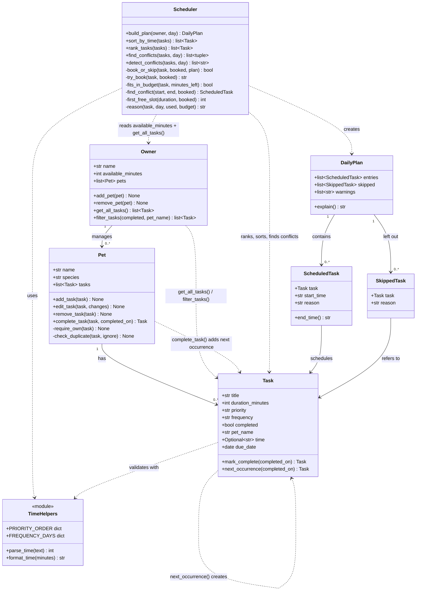

# 🐾 PawPal+

PawPal+ is a Streamlit app that helps a busy pet owner plan a day of pet care. Add your pets and their care tasks, say how much time you have, and PawPal+ builds a schedule that does the most important things first, keeps fixed appointments at their time, warns you about clashes, and explains every choice — including what it had to leave out.

## Scenario

A busy pet owner needs help staying consistent with pet care. They want an assistant that can:

- Track pet care tasks (walks, feeding, meds, enrichment, grooming, etc.)
- Consider constraints (time available, priority, owner preferences)
- Produce a daily plan and explain why it chose that plan

## ✨ Features

- **Priority-based planning** — tasks are ranked high → medium → low, then daily before weekly, then shortest first (`Scheduler.rank_tasks()`), and the plan never goes over the owner's available minutes (`Scheduler.build_plan()`).
- **Fixed-time appointments** — a task can have a set time (e.g. vet call at 09:00); it's booked at that time, and flexible tasks fill the earliest free gaps from 08:00 around it, so nothing overlaps.
- **Sorting by time** — tasks are listed in chronological order, with flexible tasks after (`Scheduler.sort_by_time()`).
- **Filtering by pet or status** — show one pet's tasks, only unfinished ones, only completed ones, or a mix (`Owner.filter_tasks()`).
- **Conflict warnings** — tasks at the same or overlapping times, for the same pet or different pets, are flagged with a plain-language warning that says which task keeps the slot and how to fix it — never a crash (`Scheduler.find_conflicts()`, `Scheduler.detect_conflicts()`).
- **Daily and weekly recurrence** — marking a task complete automatically creates the next one: due tomorrow for a daily task, in 7 days for a weekly one, counted with `timedelta` (`Task.mark_complete()`, `Task.next_occurrence()`, `Pet.complete_task()`).
- **Overdue tracking** — tasks not done on their due date stay in the plan, marked "overdue since …".
- **Explained plans** — every scheduled task says why it was chosen and how much time is used; every skipped task says why it was left out (`DailyPlan.explain()`).
- **Task management** — add, edit, complete and delete tasks, and add or remove pets, with input validation (no 0-minute tasks, no "9am" times, no duplicate unfinished tasks).
- **Tested** — 112 automated tests cover the scheduling logic and the Streamlit app itself.

## 🚀 Getting started

### Setup

```bash
python -m venv .venv
source .venv/bin/activate  # Windows: .venv\Scripts\activate
pip install -r requirements.txt
```

### Run

```bash
streamlit run app.py   # the interactive app (opens http://localhost:8501)
python main.py         # terminal demo: sorting, filtering, conflicts and today's plan
python -m pytest       # the test suite
```

## 🧩 Design Overview

The backend lives in `pawpal_system.py` (no Streamlit code there); the final class diagram is in [`diagrams/uml_final.mmd`](diagrams/uml_final.mmd) (shown below; GitHub renders it). The Phase 1 draft is in `diagrams/uml.mmd` and its git history.

- **Task** — one care activity: `title`, `duration_minutes` (how long it takes), `priority` (high/medium/low), `frequency` (daily/weekly), `completed` status, `pet_name` (which pet it belongs to), an optional `time` of day (`"HH:MM"`) for fixed appointments (tasks without one are flexible), and a `due_date` (defaults to today). Tasks validate their own fields on construction, so an invalid task can't exist. `mark_complete()` ticks a task off and returns its next occurrence (a new copy from `next_occurrence()`, due a day or a week later).
- **Pet** — pet details plus its task list. All changes go through the pet: `add_task()` (stamps the pet's name and refuses a duplicate unfinished task with the same title on the same day), `edit_task()` (changes fields in place with the same checks), `remove_task()`, and `complete_task()` (marks a task done and books its next occurrence).
- **Owner** — the owner's time available today (the scheduler's main constraint) and the pets they manage; `add_pet()` / `remove_pet()`; `get_all_tasks()` returns every pet's tasks together, and `filter_tasks(completed=..., pet_name=...)` returns only the ones matching a status, a pet, or both.
- **Scheduler** — stateless logic that reads tasks across all pets via `Owner.get_all_tasks()`, keeps the ones due on the plan day, ranks them by priority, fits them into the time budget, books fixed-time tasks at their time (skipping overlaps as conflicts) and slots flexible tasks into the free gaps. `sort_by_time()` orders tasks by time of day for display.
- **DailyPlan / ScheduledTask / SkippedTask** — the result: entries in start-time order (each with an `end_time`) and a reason for each choice, plus which tasks were left out and why. `explain()` turns the plan into readable text.



## 🛠️ Implementation Summary

PawPal+ takes a list of pet care chores and a busy owner's free time, and turns them into a realistic plan for the day — one that does the most important things first, respects fixed appointments, and is honest about what didn't fit.

**How the pieces work together**

Think of it like a household:

1. **The owner sets the limit.** An `Owner` says how many minutes they have today and which pets they look after.
2. **Each pet keeps its own to-do list.** A `Pet` holds its `Task`s — "Morning walk, 30 min, high priority, daily", or "Vet call, 15 min, at 08:15". When a task is added, the pet writes its name on it, so later we always know whose chore it is. A task checks itself when it's created, so nonsense like a 0-minute walk, a "super-urgent" priority or a time of "9am" is rejected right away, and a pet won't accept the same unfinished chore twice for one day.
3. **Chores come back.** When a chore is done, `complete_task()` ticks it off and books the next one — tomorrow for a daily task, in a week for a weekly one. Each task has a `due_date`, and only tasks due today (or overdue) are planned.
4. **The scheduler makes the decisions.** The `Scheduler` asks the owner for every pet's tasks in one go (`get_all_tasks()`), sets aside anything done or not yet due, and sorts the rest:
   - most important first (high → medium → low),
   - then daily chores before weekly ones (a skipped daily chore is a missed day; a weekly one can wait),
   - then shorter tasks first, so more of them fit.

   It walks down that list keeping each task if there's still time. Tasks with a fixed time are booked at that time; if two appointments overlap, the higher-ranked one keeps the slot and the other is skipped as a conflict. Then the flexible tasks fill the earliest free gaps from 08:00, around the appointments, so nothing ever overlaps and a flexible task never pushes an appointment out.
5. **The plan explains itself.** The result is a `DailyPlan`: scheduled tasks in clock order with start and end times, plus a list of skipped tasks. Every entry carries a short reason: why it was chosen and how much of the budget is used once it's done — "high priority, daily task, earliest free slot; 65/90 min used after this" — and every skipped task says why it was left out — "conflicts with Meds (Biscuit) at 09:20–09:30", "no free slot left today" or "not enough time left (needs 45 min, only 10 min remaining)". `explain()` reads those reasons back.

**Why it's built this way**

- **Each class has one job.** Pets and tasks just hold information; only the scheduler makes choices; the plan just reports the result. Changing one part rarely breaks another.
- **The scheduler only talks to the owner.** It never digs into individual pets, so how pets are stored can change without touching the scheduling logic.
- **Same input, same plan.** The scheduler keeps no memory between runs, which makes its behavior predictable and easy to test.

## 📐 Smarter Scheduling

Beyond basic priority planning, PawPal+ sorts, filters, detects time conflicts and handles recurring tasks. Each feature below names the method that implements it (all in `pawpal_system.py`).

### Sorting behavior — `Scheduler.sort_by_time()`

- Returns tasks in time-of-day order: fixed-time tasks earliest first, then flexible (untimed) tasks in the order they were added.
- Uses `sorted()` with a lambda key: `lambda t: (t.time is None, t.time or "")`. The first part is `False` for timed tasks and `True` for flexible ones, and `False < True`, so timed tasks come first; the second part orders them by clock time.
- Comparing `"HH:MM"` strings directly is safe because `Task` only accepts zero-padded 24-hour times (`"09:00" < "10:00"`). `sorted()` is stable and returns a new list, so the input is unchanged.
- Used by: the app's **Your Tasks** table, and `main.py`, which adds tasks out of order (17:30, 07:30, 18:00, 18:00, 08:15) and prints them sorted.

### Filtering behavior — `Owner.filter_tasks(completed=None, pet_name=None)`

- Filters tasks across all pets by **completion status**, **pet name**, or both: `filter_tasks(completed=False)` gives unfinished tasks, `filter_tasks(pet_name="Mochi")` gives Mochi's tasks, and both together give Mochi's unfinished tasks. A filter left as `None` matches everything.
- Returns the owner's real `Task` objects, so marking one complete or editing it sticks.
- Used by: the app's **Show pet** / **Show status** dropdowns, and `main.py`, which prints three filtered lists.

### Conflict detection logic — `Scheduler.find_conflicts()`, `Scheduler.detect_conflicts()` (+ `DailyPlan.warnings`, `Scheduler._find_conflict()`)

- `find_conflicts(tasks, day=None)` returns the clashing **pairs of tasks**; `detect_conflicts(tasks, day=None)` turns each pair into a warning message. Together they check **every pair** of unfinished fixed-time tasks — for the **same pet or different pets** — and returns a warning for each pair whose time ranges (start + duration) overlap on the same day. Tasks starting at the same minute get a "starts at the same time as" message; tasks that only touch (09:00–09:30, then 09:30) don't count.
- It's a **lightweight** strategy: it returns warning messages instead of raising, so the program never crashes on a conflict — callers show the warnings and carry on. Example: `Mochi's Play session (18:00–18:20) starts at the same time as Mochi's Nail trim (18:00–18:15) on 2026-10-23 — same pet`.
- `build_plan()` stores the day's warnings on `DailyPlan.warnings` (including tasks skipped for lack of time, and overdue tasks, which are planned for today), and `DailyPlan.explain()` lists them first.
- While booking, `_find_conflict()` resolves clashes: the higher-ranked task keeps the slot and the other is skipped with "conflicts with …".
- Used by: ⚠️ warnings in the app's **Your Tasks** section (as soon as a clashing task is added) and above the generated schedule, and the **⚠ CONFLICTS** section in `main.py`.

**Conflict warnings in the app — design choice.** A raw message like "Biscuit's Walk (09:00–09:30) overlaps Mochi's Vet call…" tells a pet owner that something is wrong, but not what to do about it. So the app presents a conflict to answer three questions:

1. **What clashes?** — in plain words, with the times: "Mochi's **Play** and **Nail trim** both start at **18:00**".
2. **What will PawPal+ do?** — which task keeps the slot and why: "**Play** (🟡 Medium) keeps the slot and **Nail trim** is skipped", using the scheduler's own ranking (`rank_tasks()`), so the warning and the schedule always agree.
3. **How do I fix it?** — "change one task's time under *Edit this task*, or mark it complete if it's already done".

Other choices:

- **One box, not many.** All clashes go in a single `st.warning` with a bullet each, so three clashes don't become three stacked yellow boxes.
- **Shown where it can be fixed, and when it matters.** In **Your Tasks** the warning appears as soon as a clashing task is added, next to the Edit controls. After **Generate schedule** it appears again, this time saying what actually happened in the plan ("**Walk** kept 09:00–09:30; **Vet call** was skipped"), because the first warning is only a prediction ("*if* both make the schedule").
- **A warning, not an error.** It's yellow (`st.warning`), not red (`st.error`): nothing is broken and the app keeps working — the owner just has a decision to make. The **Conflicts** count in the summary metrics makes it visible even when scrolling past.

### Recurring task logic — `Task.mark_complete()`, `Task.next_occurrence()`, `Pet.complete_task()`

- `Task.mark_complete()` marks a task done and **creates its next occurrence** via `next_occurrence()`: due today + `timedelta(days=1)` for a daily task, or + `timedelta(days=7)` for a weekly one. `Pet.complete_task()` adds the new task to the pet's list.
- Counting from the completion day means finishing an overdue task doesn't book another overdue one; a task finished early counts from its due date instead, so it still moves forward. `timedelta` handles month and year ends (Oct 31 → Nov 1, Dec 31 → Jan 1).
- Each task has a `due_date`; `build_plan()` only plans tasks due on or before the plan day, so tomorrow's copy stays out of today's plan, and overdue tasks are flagged "overdue since …".
- Used by: the app's **Mark complete** button, and `main.py`, which completes the weekly Heartworm pill so next week's dose appears in the task lists.

### Other scheduling features

| Feature | Method(s) | Notes |
|---------|-----------|-------|
| Priority ranking | `Scheduler.rank_tasks()` | Priority (high → medium → low), then daily before weekly, then shortest first. Stable sort, so the same input always gives the same plan. |
| Time budget | `Scheduler.build_plan()`, `Scheduler._fits_in_budget()`, `Scheduler._book_or_skip()` | Completed tasks and tasks not yet due are left out. A task that doesn't fit the remaining minutes waits; the loop keeps going, so a smaller task further down can still fit. If a flexible task finds no free slot, its minutes are refunded, and waiting tasks get a second try before being skipped with a reason. |
| Fixed times and gap filling | `Task.time`, `Scheduler._try_book()`, `Scheduler._first_free_slot()` | Fixed-time tasks are booked at their time; flexible tasks fill the earliest free gaps from 08:00 around them. Entries come back in clock order. A fixed task running past midnight is skipped. |
| Editing | `Pet.edit_task()`, `Pet.remove_task()`, `Owner.remove_pet()` | Edits are validated on a copy first, so a bad edit changes nothing. |

## 📸 Demo Walkthrough

### Main UI features — what a user can do

| Section | What you can do |
|---------|-----------------|
| **Owner** | Enter your name and how many minutes you have today — the time budget the plan must fit. |
| **Add a Pet** | Add a pet with a name and species; **Remove a pet** deletes it and all its tasks. Blank or duplicate names are rejected. |
| **Add a Task** | Pick a pet, enter a title, duration, priority (high/medium/low) and frequency (daily/weekly), and optionally a fixed time (`HH:MM`). Invalid input shows an error instead of being saved. |
| **Your Tasks** | See every task in a sorted table with 🔴/🟡/🟢 priority badges and ⏳/✅ status; filter by pet and status; read a ⚠️ warning if tasks clash; choose a task to **Mark complete**, **Delete**, or **Edit**. |
| **Build Schedule** | Click **Generate schedule** to see summary metrics, conflict outcomes, today's schedule with a reason for each task, the skipped tasks and why, and the full plan explanation. |

### Example workflow

A real run through the app (owner Jordan, 60 minutes free):

1. **Add pets** — add *Biscuit* (dog) and *Mochi* (cat).
2. **Add tasks** —
   - Biscuit: *Evening walk*, 30 min, 🔴 High, daily, at **18:00**; *Breakfast*, 10 min, 🔴 High, daily (flexible).
   - Mochi: *Vet call*, 15 min, 🟡 Medium, daily, at **09:00**; *Brushing*, 10 min, 🟢 Low, weekly, at **09:00**; *Play session*, 20 min, 🟡 Medium, daily (flexible).
3. **See the sorted table and the conflict warning** — **Your Tasks** lists 09:00, 09:00, 18:00, then the flexible tasks, even though they were added in a different order. Above it, one warning box appears:
   > **⚠️ 1 time conflict** — Mochi's **Vet call** and **Brushing** both start at **09:00**. If both make the schedule, **Vet call** (🟡 Medium) keeps the slot and **Brushing** is skipped. **To fix:** change one task's time under *Edit this task*…
4. **Complete a task** — choose *Breakfast* and click **Mark complete**: "Completed 'Breakfast'. Next one is due *tomorrow's date*." Set **Show status** to *Done* to see it, or *To do* to see tomorrow's copy.
5. **Generate today's schedule** — the metrics show **2 scheduled · 45/60 min · 2 skipped · 1 conflict**:
   - Schedule: 📌 Vet call 09:00–09:15, 📌 Evening walk 18:00–18:30 (Breakfast is done, so it's not planned).
   - Skipped: Brushing — "conflicts with Vet call (Mochi) at 09:00–09:15"; Play session — "not enough time left (needs 20 min, only 15 min remaining)".
   - The warning confirms: "**Vet call** kept 09:00–09:15; **Brushing** was skipped."
6. **Fix the conflict** — choose *Brushing*, open **Edit this task**, change its time to **10:00** and save. The warning disappears. Generate again: **3 scheduled · 55/60 min · 1 skipped · 0 conflicts** — Brushing now runs 10:00–10:10, and only Play session is skipped for lack of time.

### Key Scheduler behaviors shown

- **Sorting** — the task table is always in chronological order (`sort_by_time()`), whatever order tasks were added in.
- **Filtering** — the **Show pet** / **Show status** filters narrow the table and the task picker (`filter_tasks()`).
- **Conflict warnings** — same-time or overlapping fixed tasks are flagged right away and again after scheduling, with who keeps the slot and how to fix it (`find_conflicts()`); the higher-priority task keeps the slot (`rank_tasks()`).
- **Recurrence** — **Mark complete** books the next occurrence: tomorrow for daily, a week later for weekly (`mark_complete()`).
- **Budget and priority** — high-priority tasks are placed first and the plan never exceeds the available minutes; skipped tasks say why (`build_plan()`).
- **Explanations** — every scheduled and skipped task carries a reason; **Plan explanation** shows the full `explain()` text.

### CLI demo (`main.py`)

1. Set up the environment (see [Setup](#setup)) and run `python main.py` from the project folder.
2. The script creates an owner, Jordan, with 90 minutes free today, and two pets: Biscuit (dog) and Mochi (cat).
3. It adds nine tasks across the two pets, with different durations, priorities and frequencies. Five have fixed times, added out of clock order: Biscuit's "Grooming" (17:30), Biscuit's "Morning walk" (07:30), Mochi's "Play session" (18:00), Mochi's "Nail trim" (18:00) and Mochi's "Vet call" (08:15). Play session and Nail trim are at the same time (same pet), and Grooming overlaps both (different pets). Biscuit's weekly "Heartworm pill" is completed with `complete_task()`, which books next week's dose.
4. A **Tasks** section prints the tasks as added, then sorted with `Scheduler.sort_by_time()`, then filtered with `Owner.filter_tasks()`: Mochi's tasks only, completed tasks only, and Biscuit's unfinished tasks.
5. The `Scheduler` builds the plan and the terminal prints a "Today's Schedule" table in clock order: each task's time slot, pet, length and priority, with 📌 marking fixed-time tasks.
6. Below the table, a "Conflicts" section lists every overlap between fixed-time tasks, then a "Skipped" section lists the tasks that didn't make it and why, then a one-line summary of time used and time left, and finally the full `DailyPlan.explain()` text (shown below).

Sample output of `python main.py` (dates are whatever day you run it):

```
==============================================================
  🐾 TASKS
==============================================================
  As added (pet order)
  ------------------------------------------------------------
  flexible  Feeding         Biscuit  due 2026-10-23  to do
  17:30     Grooming        Biscuit  due 2026-10-23  to do
  07:30     Morning walk    Biscuit  due 2026-10-23  to do
  flexible  Heartworm pill  Biscuit  due 2026-10-23  done
  flexible  Heartworm pill  Biscuit  due 2026-10-30  to do
  flexible  Feeding         Mochi    due 2026-10-23  to do
  flexible  Litter box      Mochi    due 2026-10-23  to do
  18:00     Play session    Mochi    due 2026-10-23  to do
  18:00     Nail trim       Mochi    due 2026-10-23  to do
  08:15     Vet call        Mochi    due 2026-10-23  to do

  Sorted by time — sort_by_time()
  ------------------------------------------------------------
  07:30     Morning walk    Biscuit  due 2026-10-23  to do
  08:15     Vet call        Mochi    due 2026-10-23  to do
  17:30     Grooming        Biscuit  due 2026-10-23  to do
  18:00     Play session    Mochi    due 2026-10-23  to do
  18:00     Nail trim       Mochi    due 2026-10-23  to do
  flexible  Feeding         Biscuit  due 2026-10-23  to do
  flexible  Heartworm pill  Biscuit  due 2026-10-23  done
  flexible  Heartworm pill  Biscuit  due 2026-10-30  to do
  flexible  Feeding         Mochi    due 2026-10-23  to do
  flexible  Litter box      Mochi    due 2026-10-23  to do

  Mochi only — filter_tasks(pet_name="Mochi")
  ------------------------------------------------------------
  flexible  Feeding       Mochi  due 2026-10-23  to do
  flexible  Litter box    Mochi  due 2026-10-23  to do
  18:00     Play session  Mochi  due 2026-10-23  to do
  18:00     Nail trim     Mochi  due 2026-10-23  to do
  08:15     Vet call      Mochi  due 2026-10-23  to do

  Done — filter_tasks(completed=True)
  ------------------------------------------------------------
  flexible  Heartworm pill  Biscuit  due 2026-10-23  done

  Biscuit, to do — filter_tasks(completed=False, pet_name="Biscuit")
  ------------------------------------------------------------
  flexible  Feeding         Biscuit  due 2026-10-23  to do
  17:30     Grooming        Biscuit  due 2026-10-23  to do
  07:30     Morning walk    Biscuit  due 2026-10-23  to do
  flexible  Heartworm pill  Biscuit  due 2026-10-30  to do

==============================================================
  🐾 TODAY'S SCHEDULE
  Owner: Jordan   Pets: Biscuit (dog), Mochi (cat)
  Time available: 90 min
==============================================================
  TIME          TASK          PET       MIN  PRIORITY
  ------------------------------------------------------------
  07:30–08:00   Morning walk  Biscuit    30  HIGH 📌
  08:00–08:10   Feeding       Biscuit    10  HIGH
  08:15–08:30   Vet call      Mochi      15  MEDIUM 📌
  08:30–08:40   Feeding       Mochi      10  HIGH
  08:40–08:55   Litter box    Mochi      15  MEDIUM

  ⚠ CONFLICTS
  ------------------------------------------------------------
  ! Biscuit's Grooming (17:30–18:15) overlaps Mochi's Play session (18:00–18:20) on 2026-10-23 — different pets
  ! Biscuit's Grooming (17:30–18:15) overlaps Mochi's Nail trim (18:00–18:15) on 2026-10-23 — different pets
  ! Mochi's Play session (18:00–18:20) starts at the same time as Mochi's Nail trim (18:00–18:15) on 2026-10-23 — same pet

  SKIPPED
  ------------------------------------------------------------
  ✗ Play session  Mochi    not enough time left (needs 20 min, only 10 min remaining)
  ✗ Nail trim     Mochi    not enough time left (needs 15 min, only 10 min remaining)
  ✗ Grooming      Biscuit  not enough time left (needs 45 min, only 10 min remaining)

  Why: priority (high → low), then daily before weekly, then
  shortest first; 📌 tasks keep their fixed time, the rest fill
  the earliest free gaps from 08:00 until the time runs out.
==============================================================
  5 tasks scheduled · 80/90 min used · 10 min free
==============================================================

Details (DailyPlan.explain()):
Warning: Biscuit's Grooming (17:30–18:15) overlaps Mochi's Play session (18:00–18:20) on 2026-10-23 — different pets
Warning: Biscuit's Grooming (17:30–18:15) overlaps Mochi's Nail trim (18:00–18:15) on 2026-10-23 — different pets
Warning: Mochi's Play session (18:00–18:20) starts at the same time as Mochi's Nail trim (18:00–18:15) on 2026-10-23 — same pet
07:30–08:00 — Morning walk (30 min, Biscuit) [priority: high] — high priority, daily task, fixed time 07:30; 30/90 min used after this
08:00–08:10 — Feeding (10 min, Biscuit) [priority: high] — high priority, daily task, earliest free slot; 40/90 min used after this
08:15–08:30 — Vet call (15 min, Mochi) [priority: medium] — medium priority, daily task, fixed time 08:15; 55/90 min used after this
08:30–08:40 — Feeding (10 min, Mochi) [priority: high] — high priority, daily task, earliest free slot; 65/90 min used after this
08:40–08:55 — Litter box (15 min, Mochi) [priority: medium] — medium priority, daily task, earliest free slot; 80/90 min used after this
Skipped: Play session (Mochi) — not enough time left (needs 20 min, only 10 min remaining)
Skipped: Nail trim (Mochi) — not enough time left (needs 15 min, only 10 min remaining)
Skipped: Grooming (Biscuit) — not enough time left (needs 45 min, only 10 min remaining)
```

What to look for:

- **Sorting** — in "As added", the fixed times appear as 17:30, 07:30, 18:00, 18:00, 08:15. `sort_by_time()` puts them in clock order (07:30, 08:15, 17:30, 18:00, 18:00 — the two 18:00 tasks keep the order they were added in), followed by the flexible tasks in the order they were added.
- **Filtering** — `filter_tasks()` narrows the same list by pet, by status, or both. The "done" filter finds today's completed Heartworm pill; the "Biscuit, to do" filter shows next week's dose that `complete_task()` booked.
- **Schedule** — the completed Heartworm pill isn't planned, and next week's isn't due yet. Biscuit's Morning walk keeps its 07:30 slot and Mochi's Vet call keeps 08:15. Mochi's Feeding doesn't fit in the 5-minute gap before the Vet call, so it moves to 08:30. Play session (18:00), Nail trim (18:00) and Grooming (17:30) have fixed times but rank below the other tasks and need more than the 10 minutes left, so they're skipped.
- **Conflicts** — Mochi's Play session and Nail trim are both at 18:00, and `detect_conflicts()` prints a warning that one "starts at the same time as" the other (same pet). It also warns that Biscuit's Grooming (17:30–18:15) overlaps both (different pets). The program prints the warnings and carries on — nothing crashes. All three are skipped for lack of time, so they never got far enough to be compared while booking, but the warnings still flag them. (When two same-time tasks both fit the budget, the higher-ranked one keeps the slot and the other is skipped with "conflicts with …", alongside the warning.)

### Streamlit app — step by step

1. Run `streamlit run app.py` and open the local URL it prints (usually http://localhost:8501).
2. **Owner** — enter your name and how many minutes you have today (default 60). This is the time budget the scheduler must fit into.
3. **Add a Pet** — type a pet name, pick a species, and click **Add pet**. Repeat for each pet. A blank name or a pet you've already added is rejected with a message. **Remove a pet** (in the expander) deletes a pet and all its tasks.
4. **Add a Task** — choose which pet the task is for, then enter a title, duration, priority and frequency (daily/weekly), and optionally a **fixed time** like `09:00` (leave it blank for a flexible task). Click **Add task**. Invalid input (a blank title, a time like `9am`, or the same unfinished task twice) shows an error instead of being saved.
5. **Your Tasks** — a table of every task across all pets, fixed-time ones first in clock order, with a colored priority badge (🔴 High, 🟡 Medium, 🟢 Low), its due date and its status (⏳ To do / ✅ Done). If any fixed-time tasks clash, **one ⚠️ warning box** above the table lists every clash in plain words (e.g. "Mochi's **Play** and **Nail trim** both start at **18:00**"), says which task would keep the slot based on priority, and how to fix it. Use **Show pet** and **Show status** (All / To do / Done) to narrow the list, e.g. only Mochi's unfinished tasks; a caption shows how many of the tasks are listed. Choose a task in the dropdown (it lists only the tasks shown), then:
   - **Mark complete** — ticks it off and adds the next occurrence (tomorrow, or in a week);
   - **Delete task** — removes it;
   - **Edit this task** — change its title, duration, priority, frequency or time and click **Save changes**.
6. **Build Schedule** — click **Generate schedule**. PawPal+ shows:
   - **summary metrics**: tasks scheduled, time used out of the budget, tasks skipped, and conflicts — plus a green **"Everything fits today 🎉"** message when nothing was skipped;
   - a ⚠️ **conflict warning** (if any fixed-time tasks clash, for the same pet or different pets) saying what actually happened in this plan — which task kept the slot and which was skipped — and how to fix it;
   - a **Today's Schedule** table in clock order: start, end, task (📌 = fixed time), pet, minutes, priority badge, and *why* it was chosen;
   - a **Skipped** table for tasks that didn't make it, with their priority and the reason (not enough time, a conflict with another appointment, …);
   - a **Plan explanation** expander with the `explain()` text.
7. Change the time available or the tasks, then click **Generate schedule** again to see the plan update. Pets and tasks stay in place between clicks because the `Owner` is kept in `st.session_state`.

**Screenshot or video** *(optional)*: <!-- Insert a screenshot or link to a demo video here -->

## 🧪 Testing PawPal+

```bash
# Run the full test suite:
python -m pytest

# Run with coverage (needs `pip install pytest-cov`, not in requirements.txt):
pytest --cov
```

**What the tests cover:** the scheduler's core behaviors — **sorting** tasks into chronological order, **filtering** by pet and completion status, **recurring tasks** (completing a daily task creates one for the next day, a weekly one for a week later), **conflict detection** (tasks at the same or overlapping times are flagged with a warning, for the same pet or different pets), and **budget and priority** rules (most important tasks first, never over the available time). They also cover edge cases such as a pet with no tasks, two tasks at the exact same time, overdue tasks, and dates that cross a month or year end. A second file drives the Streamlit app itself to check that each button and form works.

`pytest.ini` points pytest at the `tests/` folder and adds the project root to the import path, so `python -m pytest` (or plain `pytest`) works from the project folder.

**Test plan — core behaviors and edge cases**

| Behavior | Happy path | Edge cases |
|----------|------------|------------|
| **Sorting correctness** (`sort_by_time()`) | Tasks added out of order come back in chronological order, across the 9 → 10 o'clock boundary | Flexible tasks last in added order; two tasks at the exact same time keep their added order; empty list; input list not changed |
| **Recurrence logic** (`mark_complete()`, `next_occurrence()`, `complete_task()`) | Completing a daily task creates a new one due the following day; weekly → 7 days later | Overdue task → next due tomorrow, not in the past; task finished early; month end, year end and leap day; tomorrow's copy stays out of today's plan |
| **Conflict detection** (`detect_conflicts()`, `build_plan()`) | Two tasks at the same time are flagged with a warning, for the same pet or different pets | Overlapping (not identical) times; back-to-back tasks are *not* conflicts; flexible, completed and other-day tasks ignored; clashing tasks skipped for time still flagged; no crash when both fit |
| **Time budget and priority** (`build_plan()`) | Higher-priority tasks first, never over the available minutes | A smaller task still fits after a bigger one is skipped; zero-gap appointments; task past midnight |
| **Empty inputs** | — | Owner with no pets; a pet with no tasks (planning, filtering and conflict checks all still work) |

There are 112 tests in two files:

| File | What it checks |
|------|----------------|
| `tests/test_pawpal.py` (88) | Task creation and validation (duration, priority, frequency, time); `mark_complete()` (and the next occurrence it creates); adding, editing and removing tasks and pets; the duplicate-task rule; priority ordering and tie-breaks; the time budget and skip reasons; fixed-time booking, gap filling around appointments, conflicts, back-to-back tasks, tasks past midnight; `detect_conflicts()` for the same pet, different pets, identical start times (with a "starts at the same time" message), same-time tasks warning instead of crashing when both fit the budget, every pair of three overlapping tasks, and the cases that aren't conflicts (touching ends, flexible, completed, other days), plus plan warnings for tasks skipped for time and for an overdue task clashing with today's; refunding the minutes of a task that finds no free slot; running budget totals in reasons; skipped tasks in rank order; start-time order and `end_time`; recurrence (`next_occurrence()`, `complete_task()`), due dates and overdue tasks; `sort_by_time()` (including same-time ties and an empty list); `filter_tasks()` by status, by pet and both together; multi-pet and empty plans. |
| `tests/test_app.py` (24) | The Streamlit app run headlessly with `AppTest`: adding pets and tasks (including fixed times), error messages for blank/duplicate/invalid input, state surviving reruns, Mark complete, Delete task, the edit form, Remove pet, the task table's time order, the pet and status filters (including no matches), weekly tasks coming back in 7 days, grouped conflict warnings (who keeps the slot, how to fix it) in the task list and schedule, priority badges, the summary metrics and "Everything fits" message, and the generated schedule, skipped table and explanation. |

Terminal output of a successful run (`python -m pytest`):

```
============================= test session starts ==============================
platform darwin -- Python 3.9.6, pytest-8.4.2, pluggy-1.6.0
rootdir: /Users/ankit/Documents/Nishi/Study Docs/CodePath/ai110-module2show-pawpal-starter
configfile: pytest.ini
testpaths: tests
collected 112 items

tests/test_app.py ........................                               [ 21%]
tests/test_pawpal.py ................................................... [ 66%]
.....................................                                    [100%]

============================= 112 passed in 4.85s ==============================
```

**Confidence Level: ★★★★☆ (4/5)**

- **Why 4:** all 112 tests pass. Every scheduling rule (sorting, filtering, recurrence, conflict detection, budget and priority) has tests that check exact results — titles, start times, due dates and warning text — not just "something came back". The edge cases most likely to break a scheduler (same-time tasks, overdue tasks, month/year ends, empty pets) are covered, and the Streamlit app is tested button by button. A refactor of `build_plan()` was also checked against the previous version on 2,000 random inputs with no differences.
- **Why not 5:** the tests only cover situations I thought of. Some combinations are untested (for example, a fixed-time task that gets a second try after a refund and then clashes with a flexible task placed in the meantime), the app was tested headlessly rather than by clicking through a real browser, and the scheduler is greedy — it's tested to follow its rules, not to find the best possible plan.
